# 🐉 Chinese Dragon Automaton
 
Final project for 3D Printing — a hand-cranked mechanical automaton that brings a
Chinese dragon to life through a system of phase-offset cams. The dragon's body
is segmented into ten individually moving parts that rise and fall sequentially,
creating the iconic undulating wave motion of the Chinese dragon in flight.
 
---
 
## 🎯 How It Works
 
A horizontal **camshaft** runs through the housing, fitted with ten eccentric cam
profiles, each rotated to a different angle relative to the others (phase-offset).
A **gear-driven hand crank** transfers rotation from the user to this shaft, with
a gear reduction (24-tooth driver meshing with a 12-tooth driven gear) that slows
the motion down for smoother, more controlled operation.
 
As the shaft turns, each cam pushes a **vertical follower rod** up and down.
Because the cams are offset in phase, the followers rise and fall at slightly
different moments — producing a **wave of vertical motion** that travels from
one end of the housing to the other.
 
Each follower is connected to one of the **ten body segments of the dragon**, so
the wave is transferred directly to the dragon's body. The result is a fluid,
undulating motion that travels from head to tail — the characteristic movement
of the Chinese dragon in traditional parades and folklore.
 
The faster the user cranks, the more dynamic the wave becomes, evoking the
dragon "flying" through clouds.
 
---
 
## 📐 Dimensions
 
Overall footprint of the assembled automaton: approximately **120 × 40 × 80 mm**
(length × width × height).
 
| Measurement              | Value     |
| ------------------------ | --------- |
| Housing length           | 113 mm    |
| Housing width            | 36 mm     |
| Housing height (frame)   | 37 mm     |
| Housing height (with top)| ~61 mm    |
| Total height (with dragon)| ~80 mm   |
| Main shaft diameter      | ~5 mm     |
| Cam profile diameter     | ~20 mm    |
| Number of cams           | 10        |
| Number of body segments  | 10        |
 
---
 
## 🧩 Components
 
The project mirrors the structure of the reference dolphin automaton, with all
mechanism parts reused and only the body segments redesigned. Each component
exists as both a Fusion 360 source file (`.f3d`) and an exported mesh (`.stl`)
for printing.
 
---
 
### Mechanism Parts (reused from reference)
 
#### Housing Frame (`Part1-Case`)
 
The outer frame of the mechanism. Houses the camshaft bearings, the crank pivot
mount, and the vertical guides for the follower rods. The frame is open on top
to accept the Housing Top cover.
 
| File          | Quantity | Role                                                     |
| ------------- | -------- | -------------------------------------------------------- |
| `Part1-Case.f3d / .stl` | 1 | Housing — outer frame with side windows, supports the shaft and follower guides |
 
**Key dimensions:** 113 × 36 × 37 mm (L × W × H). Wall thickness 2 mm. The left
side wall has a Ø6.60 mm bearing hole for the camshaft and a Ø6.00 mm hole for
the crank pivot. Interior length is 106 mm. Ten vertical slot supports are spaced
along the interior at regular intervals, each 5 mm wide and 11 mm tall, to guide
the follower rods.
 
The sketch was built from two orthogonal views — FrontSide and RightSide — and
then extruded and cut in sequence to produce the 3D shape. All critical dimensions
were set as typed constraints (not freehand) to ensure clean round values.
 
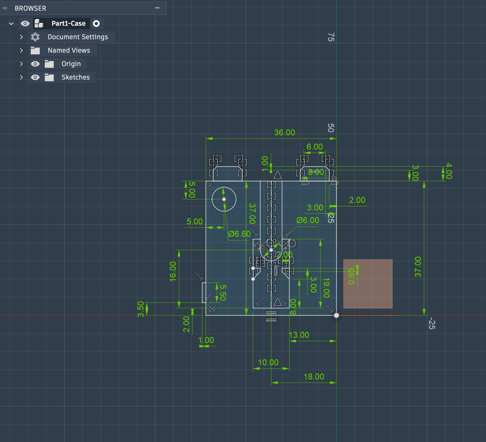
 
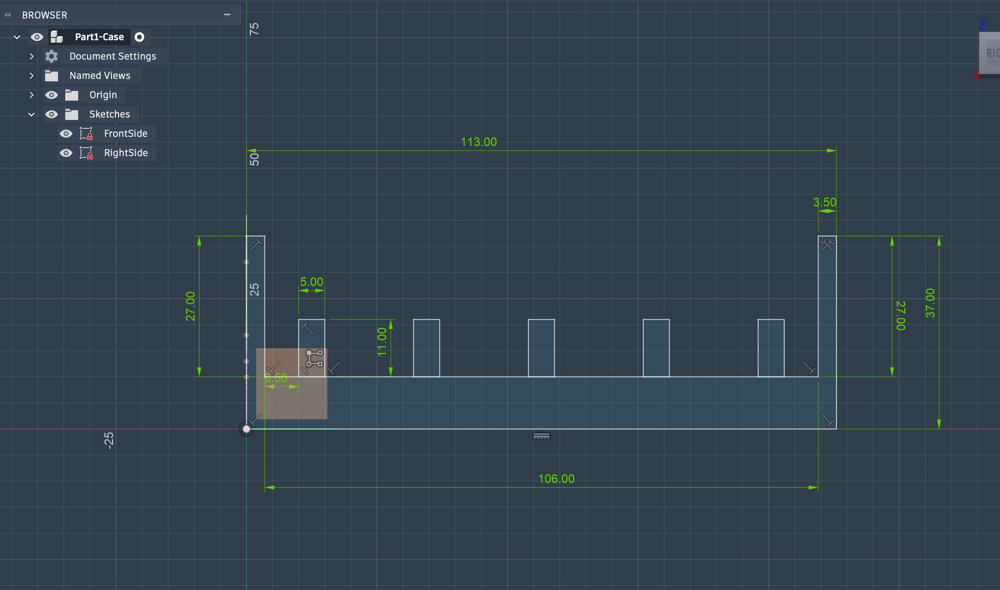
 
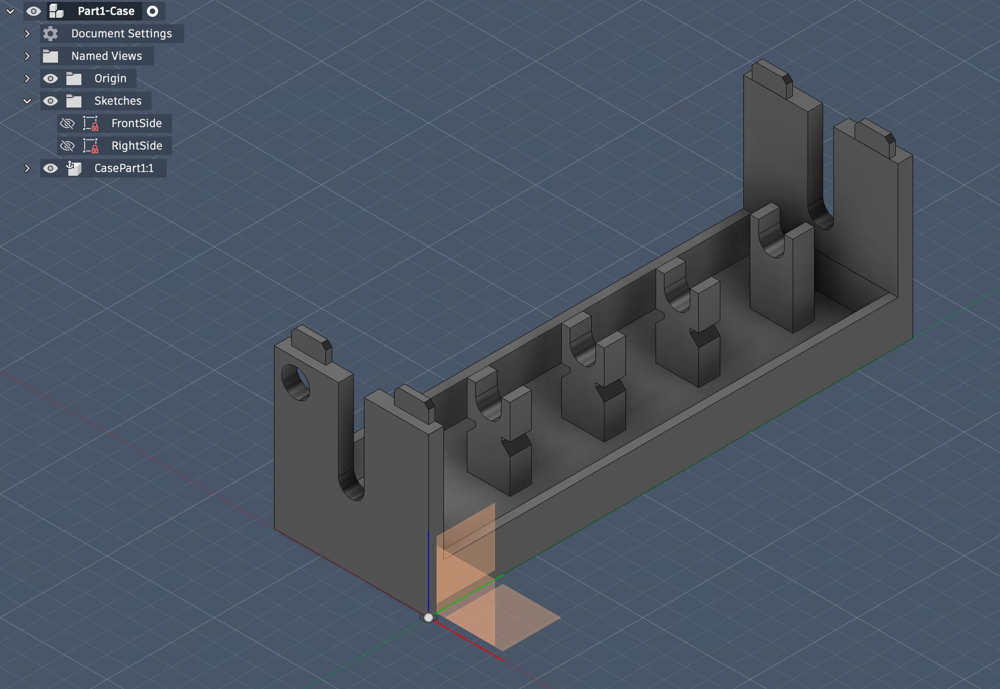
 
---
 
#### Housing Top (`Part2-Case`)
 
The top cover of the mechanism. Sits on top of the Housing Frame and features
ten vertical rectangular slots through which the follower rods pass. Two raised
posts at each end interlock with the frame. The cover also has a side opening
aligned with the crank mechanism.
 
| File          | Quantity | Role                                                     |
| ------------- | -------- | -------------------------------------------------------- |
| `Part2-Case.f3d / .stl` | 1 | Housing — top cover with ten vertical slots for the follower rods |
 
**Key dimensions:** 113 × 36 mm footprint, 24 mm height. Wall thickness 2.50 mm.
The cover's inner cavity is 104 mm long. Each of the ten follower slots is cut
through the top surface. Two mounting posts (3.50 mm wide) extend downward at
each end to align with the frame.
 
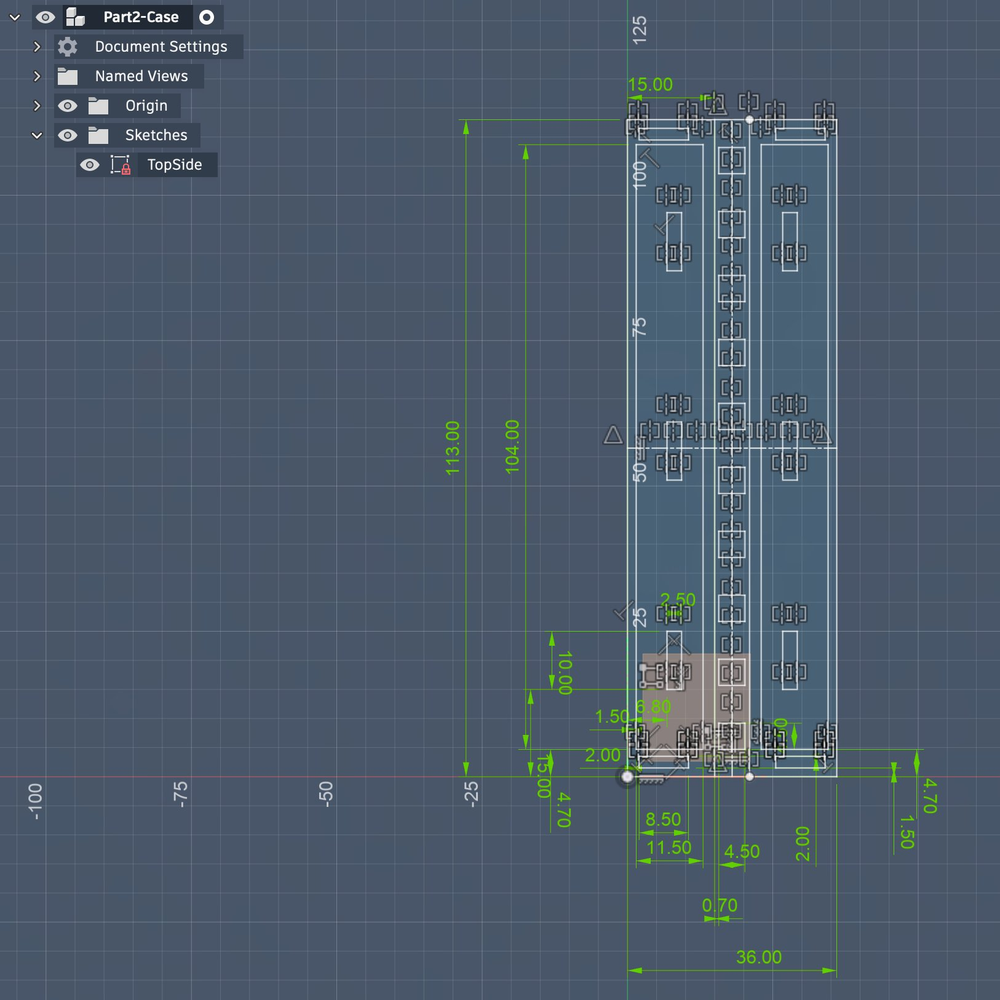
 
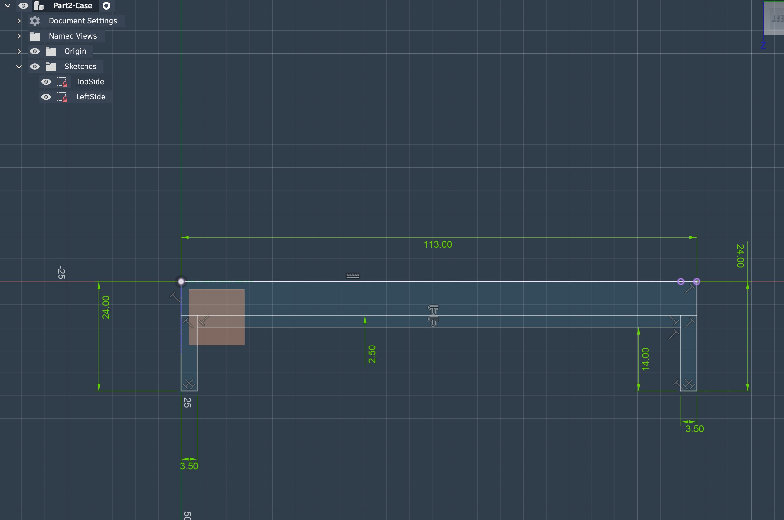
 
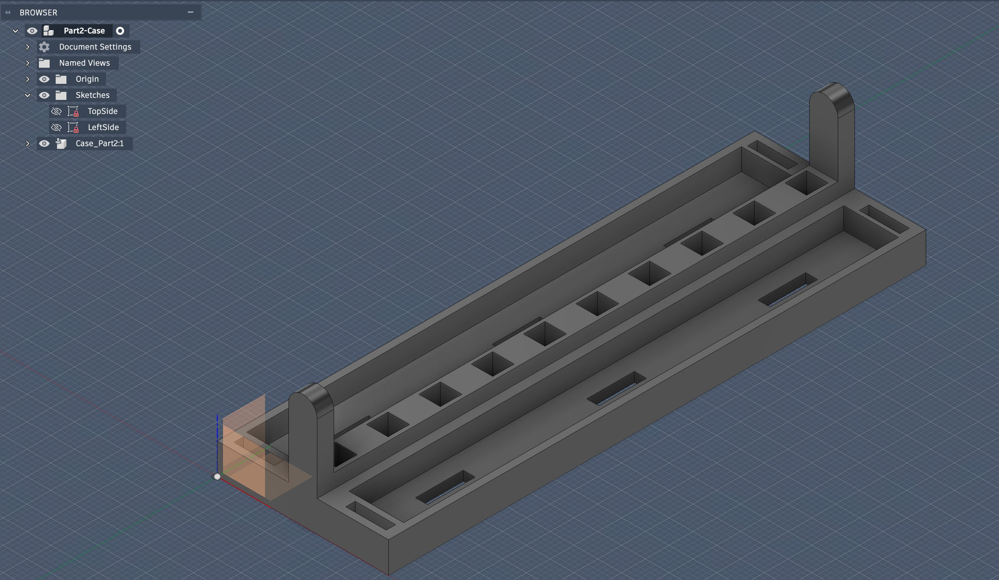
 
---
 
#### Camshaft (`Camshaft`)
 
The main drive shaft of the mechanism. A horizontal axle with ten eccentric cam
profiles integrated as a single printed piece. Each cam is rotated 36° relative
to the previous one (360° ÷ 10 = 36° per cam), producing the phase offset that
creates the wave motion.
 
| File          | Quantity | Role                                                     |
| ------------- | -------- | -------------------------------------------------------- |
| `Camshaft.f3d / .stl` | 1 | Main camshaft — horizontal axle with all ten phase-offset cam profiles |
 
**Key dimensions:** Shaft sections are 5 mm wide with 6 mm spacing between cams.
Each cam disc is approximately Ø20 mm. The total shaft length spans the full
housing interior (~106 mm). One end terminates in a 4.40 × 4.40 mm square
section that receives the Gear_small; the opposite end has a matching square
section for the Camshaft_endcap retainer.
 
The sketch (`Sketch_Shaft_base`) defines the stepped profile of the shaft with
all ten cam seat positions. A second sketch (`Sketch_Cam_profile`) defines the
eccentric cam disc geometry — a set of phase-offset circles that form the
overlapping cam lobes visible in the isometric view.
 
The shaft was modeled by first extruding the stepped base profile, then adding
each cam disc as a separate revolve or extrude operation, each rotated 36° from
the previous one.
 
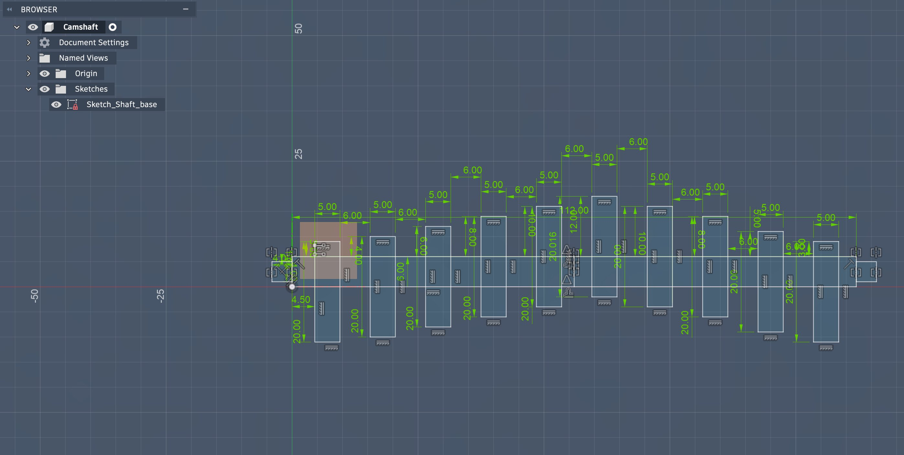
 
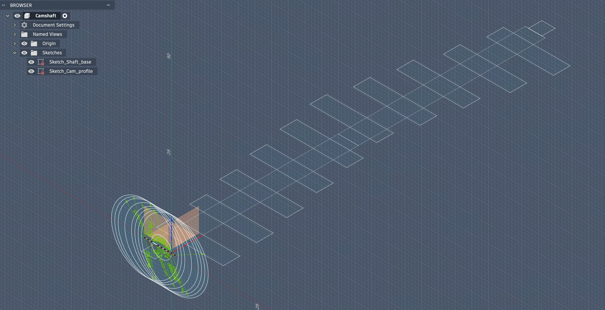
 
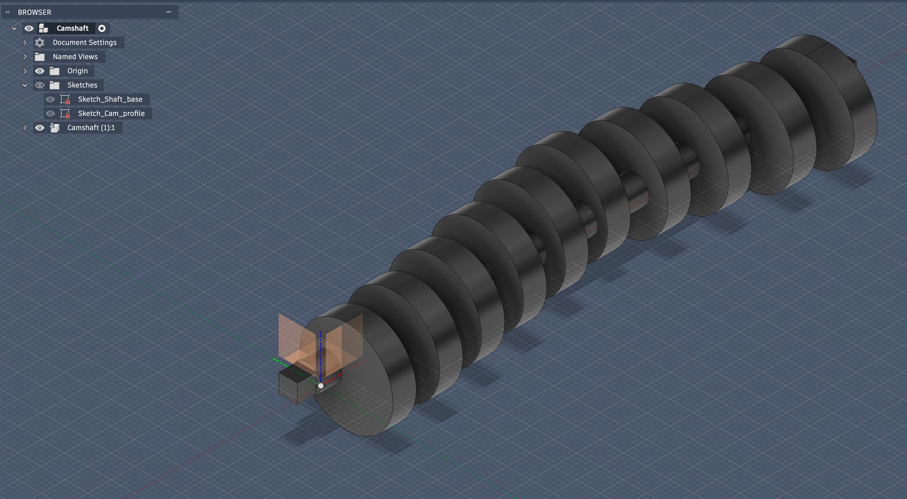
 
---
 
#### Camshaft End Cap (`Camshaft_endcap`)
 
A small cylindrical retainer that slides onto the far end of the camshaft,
keeping the shaft seated within the housing frame. The square hole mates with
the square section at the end of the camshaft.
 
| File          | Quantity | Role                                                     |
| ------------- | -------- | -------------------------------------------------------- |
| `Camshaft_endcap.f3d / .stl` | 1 | Cylindrical end cap with a square hole; retains the camshaft in the housing |
 
**Key dimensions:** Ø9.00 mm outer diameter, 4.40 mm tall. The square hole is
2.20 × 2.20 mm, matching the square section of the camshaft end.
 
The sketch (`Camshaft_base`) consists of a single concentric layout: an outer
circle at Ø9 mm and an inner rotated square at 2.20 mm half-width, then
extruded to height.
 
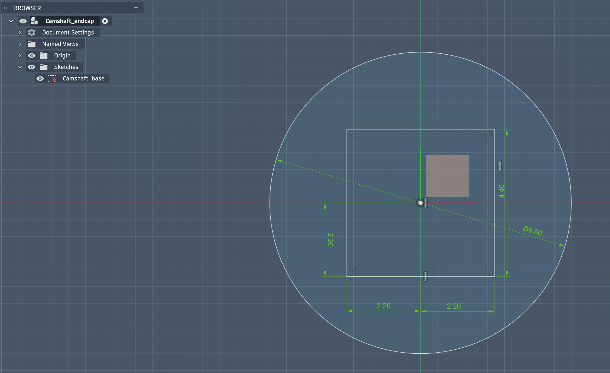
 
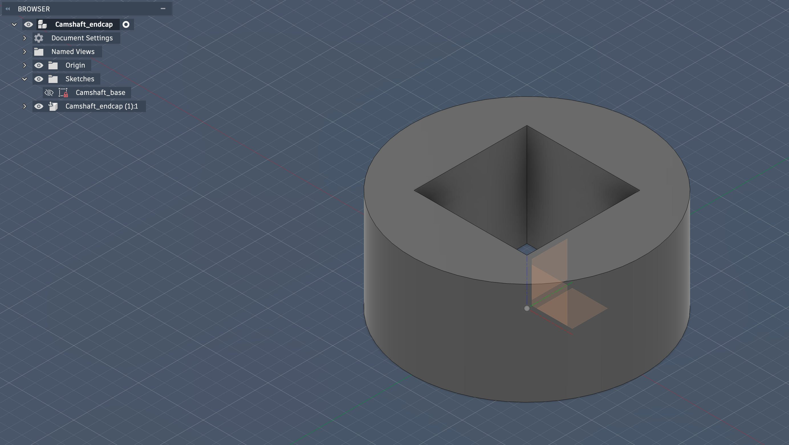
 
---
 
#### Gear Small (`Gear_small`)
 
The driven gear mounted on the camshaft. Meshes with the larger Crank_handle
gear to receive rotation from the user.
 
| File          | Quantity | Role                                                     |
| ------------- | -------- | -------------------------------------------------------- |
| `Gear_small.f3d / .stl` | 1 | Small driven gear (12 teeth) with a square hole; mounted on the gear-end of the camshaft |
 
**Teeth:** 12. Generated using Fusion 360's built-in Spur Gear add-in
(`Spur Gear 12 teeth` visible in the browser). The gear has a central square
hole that press-fits onto the square section of the camshaft, transmitting
torque without the need for a set screw or key.
 
| Parameter          | Value                      |
| ------------------ | -------------------------- |
| Standard           | Metric                     |
| Pressure Angle     | 20°                        |
| Module             | 1.0                        |
| Number of Teeth    | 12                         |
| Pitch Diameter     | 12 mm                      |
| Outer Diameter     | 14 mm                      |
| Backlash           | 0.2 mm                     |
| Root Fillet Radius | 0.2 mm                     |
| Gear Thickness     | 6 mm                       |
| Hole Diameter      | 0 mm (square hole cut separately) |
 
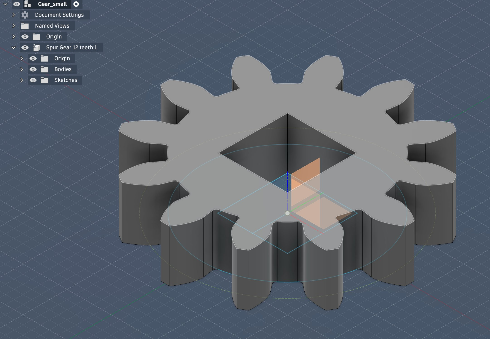
 
---
 
#### Crank Handle (`Crank_handle`)
 
The user-facing input element. A large drive gear with an integrated cylindrical
grip on top. The user turns this gear by hand; its teeth mesh with Gear_small
to drive the camshaft. The gear ratio (24 : 12 = 2 : 1) means one full turn
of the crank produces two full turns of the camshaft.
 
| File          | Quantity | Role                                                     |
| ------------- | -------- | -------------------------------------------------------- |
| `Crank_handle.f3d / .stl` | 1 | Large drive gear (24 teeth) with an integrated cylindrical grip |
 
**Teeth:** 24. Also generated with Fusion 360's Spur Gear add-in
(`Spur Gear 24 teeth` in the browser). The grip is a small cylinder with
a domed top, positioned at the center of the gear face.
 
Both gears **must** share the same module (1.0) for the teeth to mesh correctly.
 
| Parameter          | Value                      |
| ------------------ | -------------------------- |
| Standard           | Metric                     |
| Pressure Angle     | 20°                        |
| Module             | 1.0 (must match Gear_small)|
| Number of Teeth    | 24                         |
| Pitch Diameter     | 24 mm                      |
| Outer Diameter     | 26 mm                      |
| Backlash           | 0.2 mm                     |
| Root Fillet Radius | 0.2 mm                     |
| Gear Thickness     | 6 mm                       |
| Hole Diameter      | 0 mm (grip added separately)|
 
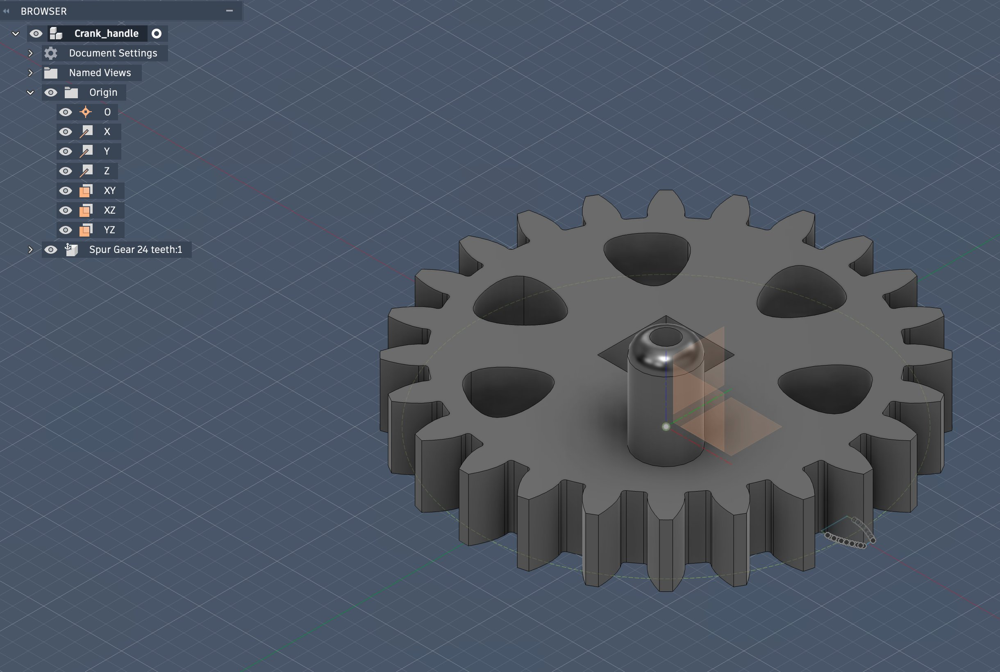
 
---
 
#### Crank Pivot (`Crank_pivot`)
 
A small auxiliary mounting part. The cylindrical base press-fits into the
housing side wall; the square top section receives the Crank_handle, allowing
it to rotate freely.
 
| File          | Quantity | Role                                                     |
| ------------- | -------- | -------------------------------------------------------- |
| `Crank_pivot.f3d / .stl` | 1 | Pivot axle — cylindrical base with a square top; Crank_handle rotates around it |
 
**Key dimensions:** The base is a three-step cylinder (Ø6.00 mm base flange →
Ø9.00 mm middle disc → square top 2.20 × 2.20 mm with R0.70 rounded corners).
Total height 3.60 mm above the mounting surface.
 
The sketch (`Crank_pivot_base`) was built as a single profile with concentric
circles and a rotated square, then revolved to create the stepped form.
 
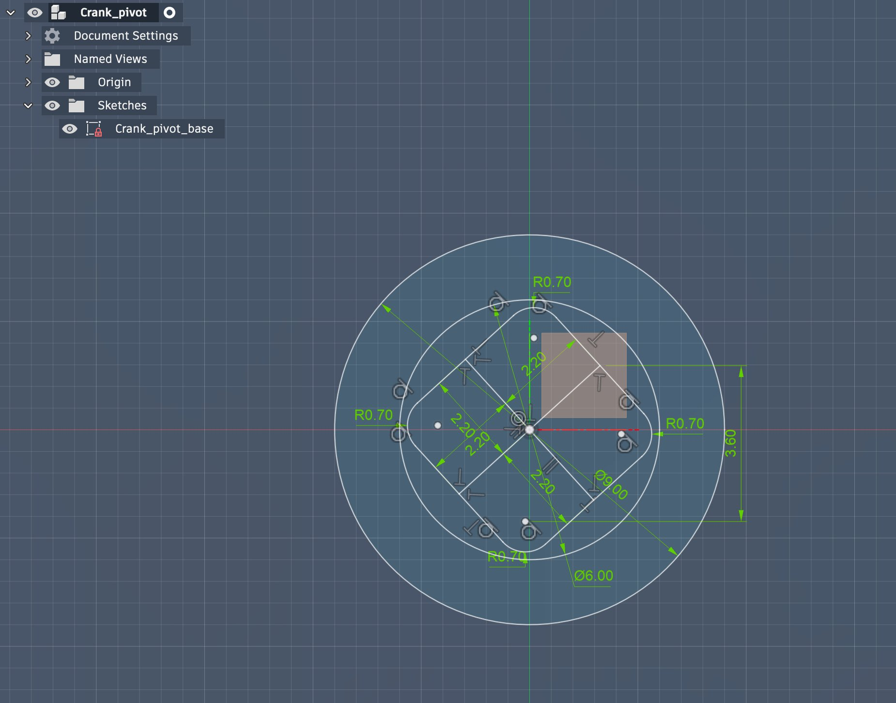
 
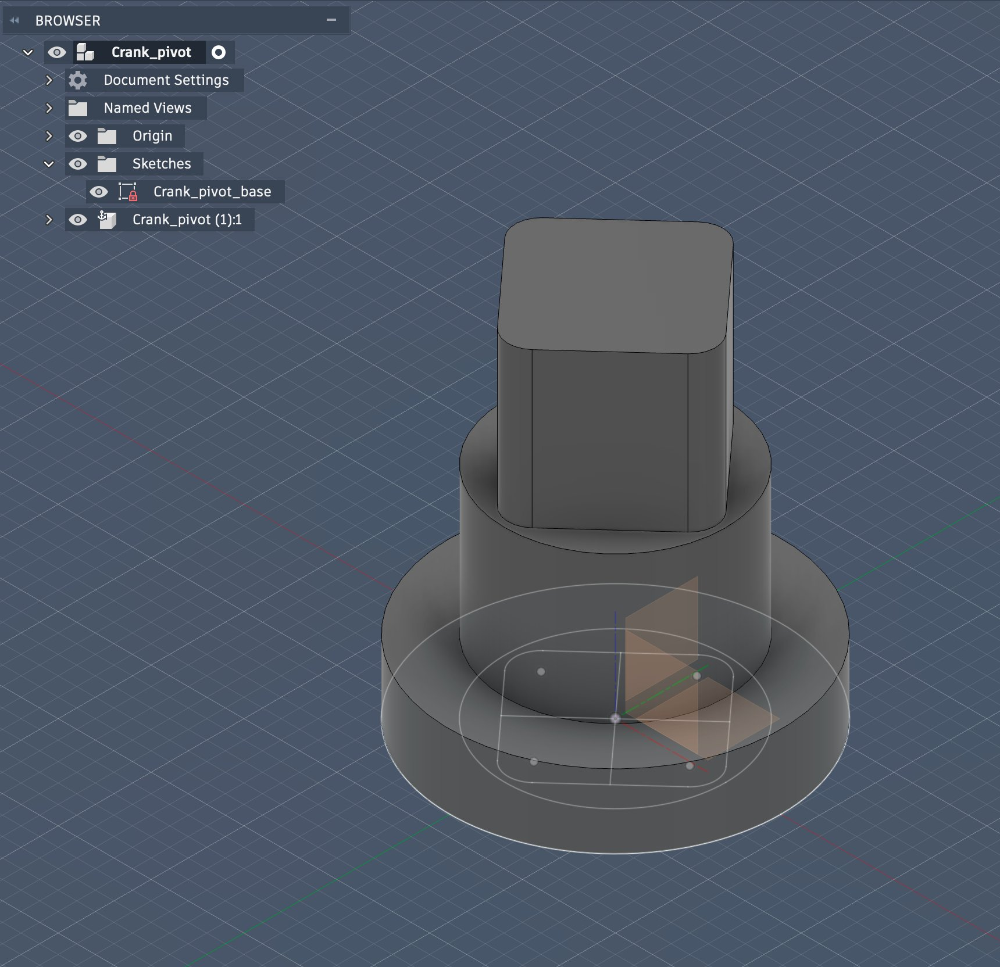
 
---
 
#### Follower Rod (`Follower_rod`)
 
A vertical rod that sits on top of a cam and transfers the cam's eccentric
motion upward to a dragon body segment. Ten identical rods are printed. The
base has a V-shaped profile that rests on the cam surface; the top has a
rounded end onto which a dragon segment snaps.
 
| File          | Quantity | Role                                                     |
| ------------- | -------- | -------------------------------------------------------- |
| `Follower_rod.f3d / .stl` | 10 | Vertical follower rod — transfers cam motion to a dragon body segment |
 
**Key dimensions:** 4.00 mm wide, 40 mm total height, with a 25 mm straight
shaft section. The top is rounded with R2.00 mm. The base is a 4 × 4 mm
block with a 1 mm chamfered V-notch that cradles the cam disc edge.
 
The rod was modeled from two sketches: `Follower_rod_front` (defining the
width and base notch) and `Follower_rod_base` (defining the side profile
with the 40 mm height and R2 top).
 
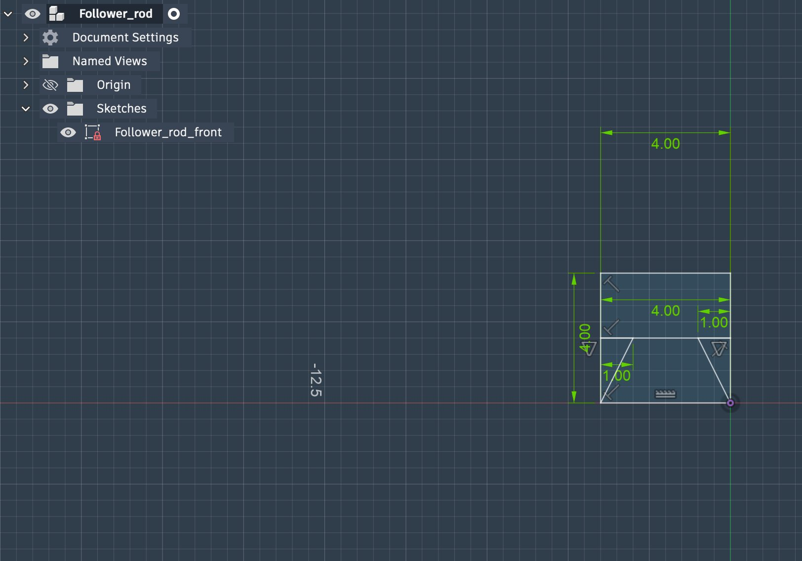
 
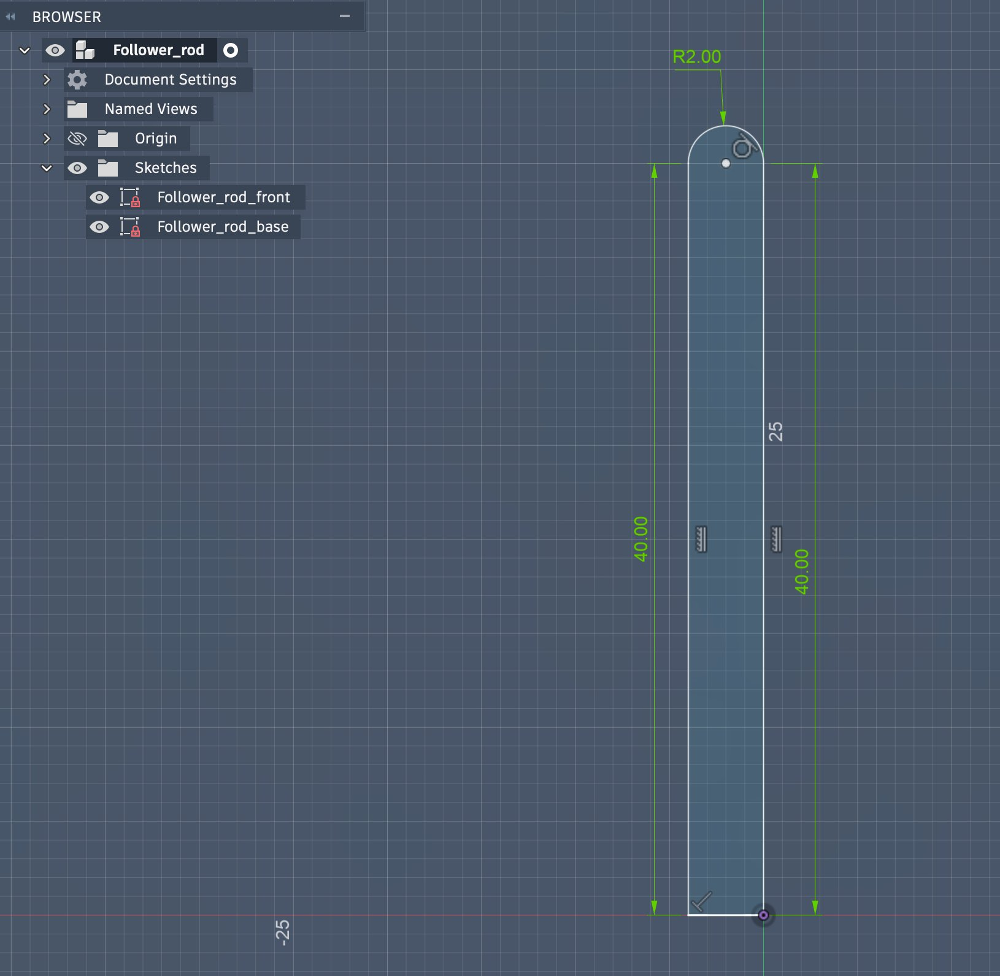
 
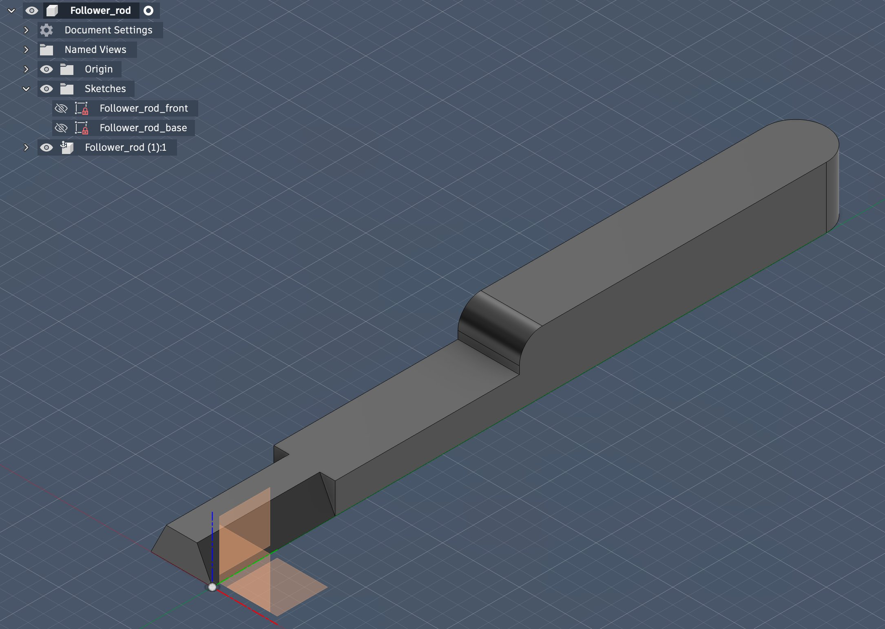
 
---
 
### Body Parts (new design for the dragon)
 
| File                     | Quantity | Role                                              |
| ------------------------ | -------- | ------------------------------------------------- |
| `dragon_p1.f3d / .stl`  | 1        | Dragon head — with horns, eyes, and traditional Chinese features |
| `dragon_p2.f3d / .stl`  | 1        | Body segment 2 — first segment behind the head    |
| `dragon_p3.f3d / .stl`  | 1        | Body segment 3                                    |
| `dragon_p4.f3d / .stl`  | 1        | Body segment 4                                    |
| `dragon_p5.f3d / .stl`  | 1        | Body segment 5 — central segment, longest dorsal spine |
| `dragon_p6.f3d / .stl`  | 1        | Body segment 6                                    |
| `dragon_p7.f3d / .stl`  | 1        | Body segment 7                                    |
| `dragon_p8.f3d / .stl`  | 1        | Body segment 8                                    |
| `dragon_p9.f3d / .stl`  | 1        | Body segment 9                                    |
| `dragon_p10.f3d / .stl` | 1        | Dragon tail — tapered, with flame or fin motif    |
 
**Summary: 18 unique designs, 27 printed parts in total** (one each for the
mechanism components except `Follower_rod`, which is printed ten times).
 
---
 
## 🎨 Design Decisions & Personal Touches
 
Going beyond a direct copy of the reference dolphin automaton, the following
intentional design choices make this project original:
 
- **Theme**: re-interpreting the mechanism in the context of Chinese mythology.
  The dragon traditionally undulates through clouds rather than through water,
  which suits the wave motion of the mechanism perfectly.
- **Body segmentation**: the dragon is split into ten segments along its length,
  matching the structure of the reference dolphin but reshaped into a serpentine
  dragon body with distinct head and tail.
- **Decorative features per segment**: dorsal spines, scaled texture, and a
  central segment with a longer ornamental spine, all referencing traditional
  Chinese dragon iconography.
- **Stylized housing**: the housing is given a Chinese-pavilion aesthetic
  (curved roof line, ornamental side windows shaped as round "coin" motifs).
- **Embossed iconography**: the Chinese character for dragon (龍) is embossed on
  the front of the housing in place of the original "DOLPHIN" lettering.
- **Color palette**: the dragon is hand-painted post-print in red and gold
  acrylic — the traditional colors of celebration and good fortune in Chinese
  culture.
- **Decorative cloud base**: a thin printed base with stylized clouds replaces
  the original wave decoration, supporting the "flying dragon" theme.
- **Gear ratio**: 24:12 (2:1 reduction) ensures smooth, controllable motion
  at the user's fingertips. One crank turn produces two camshaft turns,
  amplifying the wave speed relative to the input.
---
 
## 🛠️ Assembly Notes
 
- The `Camshaft` is printed as a single piece with all ten cam profiles
  integrated. No assembly of individual cams is required.
- Alternatively, the shaft can be replaced with a straight metal rod (Ø5 mm)
  for reduced friction and improved rotation — in this case the cam profiles
  are printed separately and slid onto the rod at the correct phase angles
  (36° apart for ten cams evenly distributed across one full rotation).
- `Gear_small` slides onto the square section (4.40 × 4.40 mm) at one end of
  the `Camshaft`, while `Camshaft_endcap` slides onto the matching square
  section at the opposite end to retain the shaft in place within the housing.
- The ten `Follower_rod` parts rest freely on top of the camshaft. Gravity holds
  them in contact with the cam surface during operation. The V-notch at the base
  of each rod cradles the cam edge for stable tracking.
- Each dragon segment attaches to its corresponding follower through a friction
  fit (a small cylindrical socket in the underside of the segment receives the
  rounded top of the follower). No glue is required.
- `Crank_handle` (24 teeth) rotates around the `Crank_pivot`, which is mounted
  in the side wall of the housing. The teeth of `Crank_handle` mesh with
  `Gear_small` (12 teeth) to drive the camshaft.
- The two housing halves (`Part1-Case` and `Part2-Case`) snap together over
  the assembled mechanism.
- Estimated assembly time: 15–20 minutes once all 27 parts are printed and
  cleaned.
---
 
## 📷 Modeling Process
 
All parts were modeled in Autodesk Fusion 360 using fully constrained parametric
sketches. Dimensions were typed as explicit values (not drawn freehand) to ensure
clean round numbers across all mating parts. The Spur Gear add-in was used for
both gears.

 
## 🚧 Project Status
 
🟡 **In development** — the repository will be updated throughout the project with:
 
- [x] All mechanism `.f3d` source files
- [ ] All `.stl` files ready for slicing
- [ ] Dragon body segment `.f3d` and `.stl` files
- [ ] Photos of the modeling process in Fusion 360
- [ ] Photos and timelapse of the printing process
- [ ] Final demonstration video showing the wave motion
- [ ] Motion study GIF
- [ ] Complete documentation and lessons learned
---
 
## 📚 References & Inspiration
 
- Reference automaton: swimming-dolphin cam-driven kinetic sculpture, GrabCAD
  Library (<https://grabcad.com/library/swimming-dolphin-1>)
- Reference video: dolphin automaton demonstration and mechanism overview
  (<https://youtu.be/Ot3GTSwU0ZI?si=-etU4ziMsodzmzp9>)
- Mechanical principles: cam–follower transmission and phase-offset shafts
  (see *507 Mechanical Movements*, Chapter VI)
- Cultural references: traditional Chinese dragon iconography in folk parades,
  temple architecture, and Year of the Dragon celebrations
